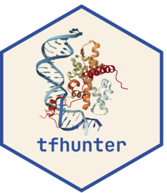

<!-- README.md is generated from README.Rmd. Please edit that file -->

```{r, include = FALSE}
knitr::opts_chunk$set(
    collapse = TRUE,
    comment = "#>",
    fig.path = "man/figures/README-",
    out.width = "100%"
)
```

# tfhunter 

<!-- badges: start -->
[](https://github.com/almeidasilvaf/tfhunter/issues)
[](https://lifecycle.r-lib.org/articles/stages.html#experimental)
[](https://github.com/almeidasilvaf/tfhunter/actions/workflows/rworkflows.devel.yml)
[](https://codecov.io/gh/almeidasilvaf/tfhunter?branch=devel)
<!-- badges: end -->


The goal of __tfhunter__ is to identify transcription factors (TFs) from 
protein sequence data of any eukaryotic species and classify them into 
families using the classification scheme of 
[CIS-BP](https://doi.org/10.1016/j.cell.2014.08.009). Plant TFs can also be
classified into families and subfamilies using the classification schemes 
implemented in [PlantTFDB](https://doi.org/10.1093/nar/gkw982) and
[TAPscan](https://doi.org/10.1111/tpj.17184), and into
structure-based families, classes, and superclasses as in
[Plant-TFClass](https://doi.org/10.1016/j.tplants.2023.06.023). Animal TFs
can be classified into structure-based superclasses, classes, and families 
as in [TFClass](https://doi.org/10.1093/nar/gkx987).

__tfhunter__ is the successor of the Bioconductor package 
[planttfhunter](https://bioconductor.org/packages/planttfhunter).

## Installation instructions

Get the latest stable `R` release from [CRAN](http://cran.r-project.org/). 
Then install __tfhunter__ from [Bioconductor](http://bioconductor.org/) 
using the following code:

```{r 'install', eval = FALSE}
if (!requireNamespace("BiocManager", quietly = TRUE)) {
    install.packages("BiocManager")
}

BiocManager::install("tfhunter")
```

Or the development version from 
[GitHub](https://github.com/almeidasilvaf/tfhunter) with:

```{r 'install_dev', eval = FALSE}
BiocManager::install("almeidasilvaf/tfhunter")
```

## Citation

Below is the citation output from using `citation('tfhunter')` in R. Please
run this yourself to check for any updates on how to cite __tfhunter__.

```{r 'citation', eval = requireNamespace('tfhunter')}
print(citation('tfhunter'), bibtex = TRUE)
```

Please note that the __tfhunter__ project was only made possible thanks to many 
other R and bioinformatics software authors, which are cited either in the 
vignettes and/or the paper(s) describing this package.

## Code of Conduct

Please note that the __tfhunter__ project is released with 
a [Contributor Code of Conduct](http://bioconductor.org/about/code-of-conduct/). 
By contributing to this project, you agree to abide by its terms.

